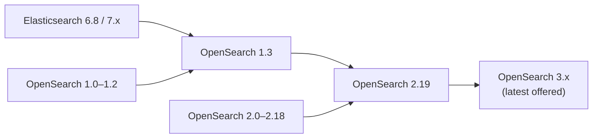
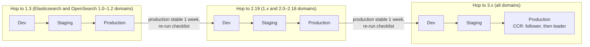

# AWS OpenSearch Upgrade Guide: Reaching OpenSearch 3.x

## Overview

This guide takes any Amazon OpenSearch Service domain, whether it runs Elasticsearch or OpenSearch today, to the latest OpenSearch 3.x release (3.7 at time of writing). It uses Terraform, one version hop at a time, with a snapshot and a rehearsal on a non-production domain before each production hop.

**Scope**

- Amazon OpenSearch Service managed domains (not OpenSearch Serverless, not self-managed clusters).
- Any starting version AWS can upgrade: Elasticsearch 6.8 and 7.x, OpenSearch 1.x and OpenSearch 2.x. Most of our domains are on OpenSearch 2.18 or 2.19; a few still run Elasticsearch.
- Domains provisioned through our Terraform module, which wraps the `aws_opensearch_domain` resource (Elasticsearch domains may still use `aws_elasticsearch_domain`; see [Elasticsearch domains: move Terraform first](#upgrade-procedure-with-terraform)).
- Every environment (dev, staging, production); production is upgraded last.

**How to use this guide**

1. [Find your upgrade path](#find-your-upgrade-path): your current version decides how many hops you need.
2. Read the [preparation for each hop](#preparation-by-hop) on your path. Only the sections for your hops apply.
3. Run every hop with the same loop: [pre-upgrade checklist](#pre-upgrade-checklist), [Terraform change](#upgrade-procedure-with-terraform), [monitoring and validation](#monitoring-and-post-upgrade-validation), then bake before the next hop, following the [rollout order](#rollout-order).

**How an AWS in-place upgrade works**

- AWS runs an upgrade as a **blue/green deployment**: it builds a new set of nodes on the target version, migrates shards to them, then removes the old nodes. The domain endpoint does not change.
- The domain stays available for reads and writes during the upgrade, but expect extra CPU, JVM and network load while shards relocate.
- Before migrating, AWS runs **pre-upgrade eligibility checks** and takes an automated snapshot. If a check fails, the upgrade stops and the domain stays on its current version.
- An upgrade **cannot be reversed in place**. The only way back is restoring a pre-upgrade snapshot into a new domain on the old version.
- Upgrade time depends on data volume and shard count; plan for anywhere from under an hour to several hours per hop on large domains.

## Why move to OpenSearch 3.x

The main reasons are support lifetime and cost: every version we run today leaves AWS standard support on 7 November 2027, after which extended support adds a per-instance-hour charge, while 3.x has no announced end date. The 3.x line is also measurably faster and adds search and vector features we can use without extra infrastructure.

**Support and cost** ([AWS version support table](https://docs.aws.amazon.com/opensearch-service/latest/developerguide/what-is.html#end-of-support))

| Version | End of standard support | End of extended support | Extended support charge |
| --- | --- | --- | --- |
| Elasticsearch 7.10 | 7 Nov 2027 | 7 Nov 2030 | $0.0065 per normalized instance hour (us-east-1) |
| Elasticsearch 7.1–7.8 | 7 Nov 2025 (passed) | 7 Nov 2027 | Equal to instance cost (doubles the instance bill) |
| OpenSearch 1.3 | 7 Nov 2027 | 7 Nov 2030 | $0.0065 per normalized instance hour |
| OpenSearch 2.11–2.17 | 7 Nov 2027 | 7 Nov 2028 | $0.0065 per normalized instance hour |
| OpenSearch 2.19 | 7 Nov 2027 | 7 Nov 2030 | $0.0065 per normalized instance hour |
| OpenSearch 3.1 and later | Not announced | Not announced | None |

AWS's table does not list 2.18 separately; treat it like 2.17 and plan to leave it first. Extended support also means critical security fixes only, no bug fixes.

**Performance** ([OpenSearch 3.0 release blog](https://opensearch.org/blog/unveiling-opensearch-3-0/))

- About 20% faster than 2.19 in aggregate on high-impact operations, and more than 9.5x faster than 1.3 on key query types.
- Range queries about 25% faster; high-cardinality aggregations up to 75% lower p90 latency.
- Built on Lucene 10 and JDK 21: faster vector indexing and smaller vector indexes.
- Star-tree indexes now cover metric aggregations and filtered terms queries, with up to 100x less query work in early results.

**Search and vector features**

- Derived source for vectors is production-ready: up to 3x less vector storage.
- Concurrent segment search is on by default for k-NN queries, up to 2.5x faster with binary quantization.
- Hybrid search gains z-score normalization and inner hits with raw scores.
- PPL adds `lookup`, `join` and `subsearch`; Query Insights adds a live-queries API.

**Security and platform**

- Field- and document-level security send less data between nodes.
- Java Security Manager replaced by a Java agent, keeping the engine on supported JDKs.

Several 3.0 additions (gRPC transport, pull-based ingestion from Kafka/Kinesis, MCP server, GPU index builds) are marked experimental upstream; do not plan around them until AWS enables them for managed domains.

## Find your upgrade path

AWS only upgrades along fixed paths, and every path to 3.x goes through OpenSearch 2.19: only 2.19 can upgrade to 3.x, only 1.3 (or 2.x) can upgrade to 2.19, and Elasticsearch can only upgrade to OpenSearch 1.x ([AWS: supported upgrade paths](https://docs.aws.amazon.com/opensearch-service/latest/developerguide/version-migration.html)).



| Current version | Hops to 3.x | Path | Preparation to read |
| --- | --- | --- | --- |
| Elasticsearch 6.8 / 7.x | 3 (plus a Terraform move) | ES → `OpenSearch_1.3` → `OpenSearch_2.19` → `OpenSearch_3.x` | [Terraform move](#upgrade-procedure-with-terraform), [to 1.3](#hop-to-opensearch-13-elasticsearch-domains), [to 2.19](#hop-to-opensearch-219), [to 3.x](#hop-to-opensearch-3x) |
| OpenSearch 1.0–1.2 | 3 | `OpenSearch_1.3` → `OpenSearch_2.19` → `OpenSearch_3.x` | [to 2.19](#hop-to-opensearch-219), [to 3.x](#hop-to-opensearch-3x) |
| OpenSearch 1.3 | 2 | `OpenSearch_2.19` → `OpenSearch_3.x` | [to 2.19](#hop-to-opensearch-219), [to 3.x](#hop-to-opensearch-3x) |
| OpenSearch 2.0–2.18 | 2 | `OpenSearch_2.19` → `OpenSearch_3.x` | [to 2.19](#hop-to-opensearch-219), [to 3.x](#hop-to-opensearch-3x) |
| OpenSearch 2.19 | 1 | `OpenSearch_3.x` | [to 3.x](#hop-to-opensearch-3x) |

**Find the current version of every domain.** The [inventory script](../opensearch-inventory/README.md) lists every domain in the given accounts and regions with its engine version, its path to 3.x and its upgrade status, as a CSV:

```bash
python opensearch-inventory/opensearch_inventory.py --regions us-east-1,us-west-2 --profiles dev,staging,prod
```

**Confirm the next hop for a specific domain** before editing Terraform:

```bash
aws opensearch get-compatible-versions --domain-name <domain-name> --region <region>
```

The response lists each `SourceVersion` with its allowed `TargetVersions`. Use the exact string it returns (for example `OpenSearch_3.7`) as the Terraform `engine_version`.

- On 2.19 you can go straight to the newest 3.x offered; you do not need to step through 3.0, 3.1 and so on. The same applies inside 2.x: go straight to 2.19.
- 3.x versions roll out region by region, so a version can appear in one region before another.
- As of this writing the AWS docs list 3.5 as the newest supported OpenSearch version and do not list 2.18. `get-compatible-versions` on the actual domain is the source of truth for both.

Budget time for the whole path, not just the upgrades: for Elasticsearch and OpenSearch 1.x domains, reindexing old indexes before the 3.x hop is usually the longest task.

## Preparation by hop

Every hop goes through the same [checklist](#pre-upgrade-checklist) and [procedure](#upgrade-procedure-with-terraform). This section covers only what is specific to each target version. Read the subsections for the hops on your path, in order.

### Hop to OpenSearch 1.3 (Elasticsearch domains)

The Elasticsearch → OpenSearch hop renames the product, so most of the work is outside the cluster ([AWS: rename summary](https://docs.aws.amazon.com/opensearch-service/latest/developerguide/rename.html)). Before this hop, [move Terraform to `aws_opensearch_domain`](#upgrade-procedure-with-terraform).

- **CloudWatch alarms break:** `ElasticsearchRequests` becomes `OpenSearchRequests`, and every `Kibana*` metric becomes `OpenSearchDashboards*`. Recreate alarms (and Grafana panels) on the new names before the upgrade.
- **Kibana → Dashboards:** `/_plugin/kibana` becomes `/_dashboards`. Update IAM/resource policies that reference the Kibana path and, for SAML, the ACS and recipient URLs in the IdP.
- **EventBridge:** the `detail-type` of domain events changes; update rules that match on it.
- **Compatibility mode:** AWS turns on `override_main_response_version` during an Elasticsearch → OpenSearch upgrade so the cluster reports version 7.10 to old Elasticsearch clients. Use it only as a bridge until clients are replaced; it must be off before the 3.x hop.
- **Unchanged:** domain ARN, endpoint, service principal `es.amazonaws.com`, CloudWatch namespace `AWS/ES`, IAM action prefix `es:`.

OpenSearch 1.0–1.2 domains only need the standard checklist for their hop to 1.3.

### Hop to OpenSearch 2.19

From any 2.x release this is a minor upgrade: the standard checklist is enough. From 1.3 (including domains that started on Elasticsearch), also do the following before the hop:

- **Clients:** official Elasticsearch clients refuse to talk to OpenSearch 2.0+. Replace `elasticsearch-py` with `opensearch-py` (and the equivalents in other languages) and deploy them first.
- **Indexes created in Elasticsearch 6.x** must be reindexed (or deleted) before OpenSearch 2.3+, including UltraWarm and cold indexes.
- **Start planning the 3.x reindex now:** every index created before OpenSearch 2.0 has to be reindexed before the 3.x hop (see the next section). 2.19 is where that reindex runs, so size the work before you get there.

### Hop to OpenSearch 3.x

OpenSearch 3.0 is a major release built on Lucene 10 and JDK 21; the version jump itself is handled by AWS, but removed settings, removed APIs and old indexes are on us. Full list: [OpenSearch breaking changes – 3.0.0](https://docs.opensearch.org/latest/breaking-changes/#300).

**Upgrade blockers on AWS** (the pre-upgrade check fails if any are present)

| Blocker | What to do |
| --- | --- |
| Index setting `index.knn.algo_param.ef_construction` | Remove from index settings and templates; set it in the k-NN field mapping `method.parameters` instead |
| Index setting `index.knn.algo_param.m` | Same as above |
| Index setting `index.knn.space_type` | Move to the k-NN field mapping (`space_type`) |
| Index setting `index.store.hybrid.mmap.extensions` | Remove from index settings and templates |
| Indexes created before OpenSearch 2.0 (on Elasticsearch or OpenSearch 1.x; hot, UltraWarm or cold) | Reindex into a new index, or delete; move warm/cold indexes to hot first |
| Manual snapshots taken on Elasticsearch or OpenSearch 1.x in a registered repository | Delete them from the repository (keep a copy in S3 outside the repository if you need history) |
| Cross-cluster connections that would be incompatible after the upgrade | Upgrade the remote domain too, or remove the connection (see [cross-cluster replication](#domains-with-cross-cluster-replication)) |

Reindex with `_reindex` into a new index and an alias swap, so applications see no downtime.

**Leftovers from Elasticsearch and OpenSearch 1.x** (only if the domain started on one of them)

- **Compatibility mode:** set `compatibility.override_main_response_version` to `false` and confirm all clients still work. The setting is removed in 3.0.
- **Endpoints:** move every `_opendistro/...` call (SQL, ISM, alerting, security) to `_plugins/...`; the SQL `_opendistro` endpoints are removed in 3.0.

**Behaviour changes to check in application code**

- **System indexes:** direct REST access to system indexes is removed.
- **Document IDs:** the 512-byte `_id` limit is now enforced everywhere, including `_bulk`.
- **JSON limits:** max nesting depth 1,000; max property name length 50,000. New `index.query.max_nested_depth` defaults to 20.
- **k-NN:** `knn.plugin.enabled` removed; the NMSLIB engine is deprecated — create new vector indexes with `faiss` or `lucene`.
- **SQL plugin:** `opendistro`-prefixed endpoints and settings removed; `DELETE` statements removed; DSL response format removed; pagination defaults to Point in Time.
- **Settings removed:** `compatibility.override_main_response_version`, `thread_pool.test.*_queue_size`, `transport-nio`.
- **Analyzers:** `PathHierarchy` tokenizer name deprecated in favour of `path_hierarchy`; Romanian analyzer output changed (reindex Romanian-text indexes).
- **Security plugin:** the Blake2b salt fix changes hash output for field masking — masked values will differ from those produced on 2.x.
- **Workload management:** `query_group` APIs and settings renamed to `workload_group`.
- **ML Commons:** `CatIndexTool` replaced by `ListIndexTool`; `_batch_ingestion` API removed.
- **Dashboards:** legacy Observability notebooks are unsupported (migrate first); the Gantt chart visualization and the old Discover DataGrid toggle are removed.

**Clients and integrations**

| Component | Requirement for 3.x |
| --- | --- |
| `opensearch-py` | 3.x client (supports OpenSearch 1.0–3.x) — upgrade the client **before** the cluster ([compatibility](https://github.com/opensearch-project/opensearch-py/blob/main/COMPATIBILITY.md)) |
| Other OpenSearch clients (Java, JS, Go) | Move to the 3.x line of each client; check each repo's COMPATIBILITY.md |
| Elasticsearch clients | Not supported against OpenSearch 2.0+; replace them |
| Firehose, CloudWatch Logs subscriptions, OSI pipelines, Logstash | Confirm the service/plugin supports the target version before upgrading ([AWS note](https://docs.aws.amazon.com/opensearch-service/latest/developerguide/version-migration.html)) |

## Pre-upgrade checklist

Complete every item for each domain and each hop; if one fails, stop and fix it before touching Terraform. Thresholds below are the ones AWS enforces in its eligibility check ([AWS: troubleshooting an upgrade](https://docs.aws.amazon.com/opensearch-service/latest/developerguide/version-migration.html#upgrade-failures)).

**Automated check:** run [`opensearch-upgrade-checker/opensearch_upgrade_checker.py`](../opensearch-upgrade-checker/README.md) first. It detects the current version, works out the path, covers most cluster-side items below for the next hop, and exits with code 2 if anything blocks it. It is strictly read-only: OpenSearch requests are limited to GET/HEAD and AWS calls to `DescribeDomain` / `GetCompatibleVersions`, enforced in code.

```bash
pip install -r opensearch-upgrade-checker/requirements.txt
python opensearch-upgrade-checker/opensearch_upgrade_checker.py \
  --domain-name <domain-name> --region <region> \
  --role-arn <read-only-role-arn> --json <domain-name>-check.json
```

The items it cannot see — client versions, removed API calls in application code, integrations, CloudWatch history, rehearsal and change window — still need a manual tick.

**Cluster health (every hop)**

- [ ] Cluster status is `green` (`GET _cluster/health`); no red indexes (`GET _cat/indices?health=red`).
- [ ] JVM memory pressure below 75% on all nodes (CloudWatch `JVMMemoryPressure`, max over 24h).
- [ ] Disk usage below 90% on every node, ideally below 70% to give shard relocation room (`GET _cat/allocation?v`).
- [ ] Fewer than 1,000 shards per node (`GET _cat/allocation?v` → shards column).
- [ ] No 5xx spikes, no long pending-task queue (`GET _cluster/pending_tasks`).
- [ ] Domain not in `Processing` and no snapshot running (`GET _snapshot/_status`).
- [ ] Dedicated master nodes enabled (3 recommended) on production domains.

**Hop-specific items** (from [Preparation by hop](#preparation-by-hop))

- [ ] **To 1.3 from Elasticsearch:** Terraform moved to `aws_opensearch_domain`; CloudWatch alarms, IAM/resource policies, SAML URLs and EventBridge rules updated for the rename.
- [ ] **To 2.19 from 1.3:** Elasticsearch clients replaced and deployed; no index created in Elasticsearch 6.x.
- [ ] **To 3.x:** no index or index template carries the four removed settings. Check with:

```bash
GET _all/_settings?flat_settings=true&filter_path=*.settings.index.knn.algo_param*,*.settings.index.knn.space_type,*.settings.index.store.hybrid*
GET _index_template?filter_path=**.settings
```

- [ ] **To 3.x:** no index created before OpenSearch 2.0 (`GET _all/_settings?filter_path=*.settings.index.version.created_string&human`); reindex or delete any hit, including UltraWarm and cold.
- [ ] **To 3.x:** no manual snapshots from Elasticsearch or OpenSearch 1.x left in registered snapshot repositories.
- [ ] **To 3.x:** compatibility mode off; no `_opendistro` calls left; no new vector indexes on the `nmslib` engine.

**Applications and integrations (every hop)**

- [ ] Every service talking to the domain uses a client that supports the target version (`opensearch-py` 3.x before the 3.x hop) and has been deployed.
- [ ] Grep application code for APIs removed in the target version (for 3.x: `_opendistro/_sql`, `knn.plugin.enabled`, `query_group`, direct system-index reads).
- [ ] Firehose, CloudWatch Logs subscriptions, OSI pipelines and Logstash confirmed to support the target version.
- [ ] CCR leader/follower pairs identified; follower scheduled before leader.

**Safety net (every hop)**

- [ ] Manual snapshot taken to our S3 repository just before the upgrade and confirmed `SUCCESS`:

```bash
PUT _snapshot/<repo-name>/pre-upgrade-<domain>-<yyyymmdd>
GET _snapshot/<repo-name>/pre-upgrade-<domain>-<yyyymmdd>
```

- [ ] Dry-run eligibility check passes for the next hop (no version change is applied):

```bash
aws opensearch upgrade-domain \
  --domain-name <domain-name> \
  --target-version <next-hop-version> \
  --perform-check-only

aws opensearch get-upgrade-status --domain-name <domain-name>
```

- [ ] Upgrade rehearsed on a non-production domain restored from a production snapshot, and application smoke tests pass against it.
- [ ] Change window agreed, low-traffic period chosen, on-call informed.

## Upgrade procedure with Terraform

An upgrade is a one-line change to `engine_version`, applied one hop at a time in its own PR; the AWS provider updates `aws_opensearch_domain` in place by calling the `UpgradeDomain` API and waits for it to finish.

**0. Elasticsearch domains only: move Terraform to `aws_opensearch_domain`**

The legacy `aws_elasticsearch_domain` resource cannot express OpenSearch versions, so switch the module to `aws_opensearch_domain` before the first upgrade. The domain ARN and endpoint do not change, so this is a state move, not a rebuild. With Terraform 1.7+:

```hcl
removed {
  from = module.search_prod.aws_elasticsearch_domain.this
  lifecycle {
    destroy = false # forget it in state, never delete the domain
  }
}

import {
  to = module.search_prod.aws_opensearch_domain.this
  id = "search-prod" # domain name
}
```

- Rename `elasticsearch_version = "7.10"` to `engine_version = "Elasticsearch_7.10"` and `cluster_config.instance_type` values from `*.elasticsearch` to `*.search`.
- `terraform plan` must show one import, one removal from state, and **no** `destroy` or `must be replaced`. Fix any diff until the plan is otherwise empty, then apply.
- Keep `prevent_destroy = true` on the new resource before the first apply.

**1. Prepare the module**

Make sure the module exposes the engine version and the resource timeouts. Minimal shape inside the module:

```hcl
variable "engine_version" {
  description = "Engine version, e.g. Elasticsearch_7.10, OpenSearch_2.19 or OpenSearch_3.7"
  type        = string
}

resource "aws_opensearch_domain" "this" {
  domain_name    = var.domain_name
  engine_version = var.engine_version

  # ... cluster_config, ebs_options, encrypt_at_rest, advanced_security_options ...

  timeouts {
    update = "6h" # provider default is 180m; large domains can take longer
  }

  lifecycle {
    prevent_destroy = true
  }
}
```

- Keep `prevent_destroy = true` on production domains so a bad plan can never replace the domain.
- Pin the AWS provider to a current 5.x/6.x release that knows the target version string.
- Keep every `advanced_options` value a quoted string to avoid perpetual diffs.

**2. Change only the version (one hop per PR)**

Set `engine_version` to the next hop on your path, never further:

```hcl
module "search_prod" {
  source         = "../modules/opensearch"
  domain_name    = "search-prod"
  engine_version = "OpenSearch_2.19" # was OpenSearch_2.18; next PR: OpenSearch_3.7
  # ...
}
```

Do **not** bundle instance type, node count, EBS, access policy or any other change in the same apply. AWS rejects configuration changes while an upgrade is running, and mixing them makes failures hard to diagnose.

**3. Plan and review**

```bash
terraform plan -target=module.search_prod -out=upgrade.tfplan
```

The plan must show exactly one change: `~ update in-place` on `engine_version` from the current version to the next hop. If it shows `-/+ must be replaced`, stop: something else in the config forces replacement (VPC options, encryption, KMS key, FGAC disable).

**4. Apply in the change window**

```bash
terraform apply upgrade.tfplan
```

Run it from CI or a long-lived session (not a laptop that may sleep). If Terraform times out, the upgrade keeps running in AWS; do not re-apply until `get-upgrade-status` reports `SUCCEEDED`, then run `terraform plan` to confirm no drift.

**5. Repeat for the next hop**

After [validation](#monitoring-and-post-upgrade-validation) and the bake time in the [rollout order](#rollout-order), read the [preparation](#preparation-by-hop) for the next hop, re-run the checklist (hop-specific checks change with the target), then open the next PR.

**CLI equivalents** (for emergencies or for checking state outside Terraform)

| Purpose | Command |
| --- | --- |
| Allowed targets | `aws opensearch get-compatible-versions --domain-name <d>` |
| Eligibility check only | `aws opensearch upgrade-domain --domain-name <d> --target-version <version> --perform-check-only` |
| Start the upgrade | `aws opensearch upgrade-domain --domain-name <d> --target-version <version>` |
| Current step and status | `aws opensearch get-upgrade-status --domain-name <d>` |
| Past attempts and failures | `aws opensearch get-upgrade-history --domain-name <d>` |

If you upgrade with the CLI, update `engine_version` in Terraform straight after, otherwise the next `apply` will try to downgrade and fail.

## Monitoring and post-upgrade validation

An upgrade is done when `get-upgrade-status` reports `SUCCEEDED`, the cluster is green on the new version, and application smoke tests pass. AWS reports three steps — `PRE_UPGRADE_CHECK`, `SNAPSHOT`, `UPGRADE` — and the whole run takes from about 15 minutes to several hours ([AWS](https://docs.aws.amazon.com/opensearch-service/latest/developerguide/version-migration.html)). Dashboards may be unavailable for part of it.

**While it runs**

```bash
watch -n 60 aws opensearch get-upgrade-status --domain-name <domain-name>
```

Watch these CloudWatch metrics (namespace `AWS/ES`) and pause other heavy jobs (reindexing, bulk backfills) until it finishes. After an Elasticsearch → OpenSearch hop, use the renamed metrics (`OpenSearchRequests`, `OpenSearchDashboards*`).

| Metric | Watch for |
| --- | --- |
| `ClusterStatus.red` / `ClusterStatus.yellow` | Red at any point; yellow is normal during shard relocation |
| `JVMMemoryPressure` | Sustained > 80% |
| `CPUUtilization` | Sustained > 85% on data nodes |
| `FreeStorageSpace` | Dropping toward 10% of volume |
| `5xx`, `ThreadpoolWriteRejected`, `ThreadpoolSearchRejected` | Spikes affecting clients |
| `Nodes` | Count roughly doubles during blue/green, then returns to normal |

**After it finishes**

- [ ] `GET /` returns the new `version.number` (with compatibility mode on, check `GET _cat/nodes?h=version` instead); `GET _cluster/health` is `green`.
- [ ] Document counts match the pre-upgrade baseline (`GET _cat/indices?v&s=index`).
- [ ] `GET _cat/plugins?v` shows the expected plugins on every node.
- [ ] Index templates, ISM policies, aliases and snapshot repositories still present.
- [ ] Application smoke tests pass (search, indexing, any k-NN/vector queries, SQL/PPL if used).
- [ ] OpenSearch Dashboards loads; saved objects, index patterns and alerting monitors work.
- [ ] CCR: `GET _plugins/_replication/<index>/_status` is `SYNCING` with leader and follower checkpoints converging.
- [ ] `terraform plan` shows no changes for the domain.
- [ ] Error rate and latency dashboards stable for 24 hours before the next hop or the next environment.
- [ ] Take a fresh manual snapshot on the new version.

## Rollback and failure recovery

There is no in-place downgrade: once a domain is on a new version it stays there, and a snapshot from a newer version cannot be restored into an older domain. Recovery depends on where the upgrade stopped.

| Situation | What happens | What to do |
| --- | --- | --- |
| Pre-upgrade check fails | Nothing changes; domain stays on the old version | Read `get-upgrade-history` for the reason, fix it (see checklist), retry |
| Snapshot step fails or times out | Upgrade does not start | Check cluster health and running snapshots, retry later |
| Upgrade step fails | AWS restores the domain to its original version from the pre-upgrade snapshot | Confirm version and health, open an AWS Support case if the cause is unclear, then retry |
| Upgrade succeeds but the application breaks | Domain is on the new version; cannot go back in place | Fix forward in the app (preferred), or build a new domain on the old version and restore the manual pre-upgrade snapshot into it |
| Terraform times out mid-upgrade | Upgrade continues in AWS | Wait for `SUCCEEDED`, then `terraform plan` / `apply` to reconcile state; never re-apply while it runs |

**Restore-to-old-version runbook** (last resort)

1. Create a new domain with the previous `engine_version` (the version before this hop) through the same Terraform module under a new name.
2. Register the same S3 snapshot repository on the new domain (same IAM role).
3. Restore the manual pre-upgrade snapshot, excluding system indexes: `POST _snapshot/<repo>/pre-upgrade-<domain>-<yyyymmdd>/_restore` with `"indices": "-.*"`.
4. Replay writes made since the snapshot from the source system, if any.
5. Point applications at the new endpoint (or swap a custom endpoint / DNS record), then decommission the upgraded domain.

This is why the manual snapshot in the checklist is mandatory, and why each hop is rehearsed outside production first.

## Rollout order

Roll each hop through dev, staging and production before starting the next hop, so every environment spends time on each intermediate version before any of them moves on. Domains join at the hop their path starts with: Elasticsearch domains at the 1.3 hop, 1.x and 2.0–2.18 domains at the 2.19 hop, 2.19 domains at the 3.x hop.



Bake each environment 2–3 days on the new version before promoting. Bake times are our recommendation, not an AWS requirement.

- Upgrade one domain per change window; never two production domains at once.
- Record each upgrade (domain, from/to version, start/end time, issues) in the INFRA ticket; re-run the [inventory script](../opensearch-inventory/README.md) to track the fleet.

### Domains with cross-cluster replication

If a domain is a leader or follower in CCR (see our `opensearch-ccr-poc`), AWS blocks an upgrade that leaves the connection incompatible. For every hop:

- Upgrade the **follower first**, then the leader, in the same change window, and keep both on the same version family.
- Verify `_plugins/_replication/<index>/_status` after each step.
- Never delete the connection during the upgrade: replication pauses and cannot be resumed ([AWS: upgrading connected domains](https://docs.aws.amazon.com/opensearch-service/latest/developerguide/replication.html#replication-upgrade)). Paused replication also cannot be resumed after 12 hours, so keep the gap between the follower and leader upgrades short.

## References

- [Upgrading Amazon OpenSearch Service domains](https://docs.aws.amazon.com/opensearch-service/latest/developerguide/version-migration.html) — upgrade paths, 3.x blockers, eligibility failures
- [Amazon OpenSearch Service rename summary](https://docs.aws.amazon.com/opensearch-service/latest/developerguide/rename.html) — what changes in the Elasticsearch → OpenSearch hop
- [Amazon OpenSearch Service version support](https://docs.aws.amazon.com/opensearch-service/latest/developerguide/what-is.html#end-of-support) — standard and extended support dates
- [Cross-cluster replication – upgrading connected domains](https://docs.aws.amazon.com/opensearch-service/latest/developerguide/replication.html#replication-upgrade)
- [OpenSearch breaking changes – 3.0.0](https://docs.opensearch.org/latest/breaking-changes/#300)
- [OpenSearch 3.0 release blog](https://opensearch.org/blog/unveiling-opensearch-3-0/)
- [opensearch-py compatibility matrix](https://github.com/opensearch-project/opensearch-py/blob/main/COMPATIBILITY.md)
- [Terraform `aws_opensearch_domain` resource](https://registry.terraform.io/providers/hashicorp/aws/latest/docs/resources/opensearch_domain)
- [AWS re:Post – Upgrading from v2.x to 3.x](https://repost.aws/articles/ARJmI4RiskRji3rRXhmi-9IA/upgrading-amazon-opensearch-domain-from-v2-x-to-3-x-prerequisites-breaking-changes-and-best-practices)
